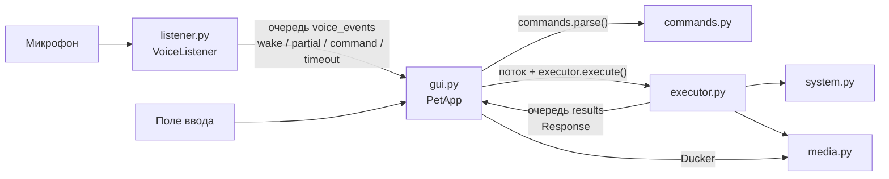
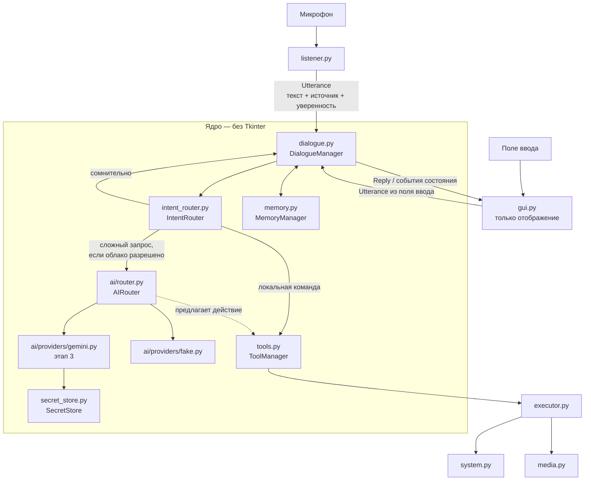

# План архитектурной миграции (этап 2)

**Статус:** согласован владельцем (см. раздел 9).
**База:** коммит `6c2411e`, метка `stage1-checkpoint`.

## 1. Текущая архитектура



**Главная проблема — `gui.py` делает слишком много.** Кроме анимаций и реплик
он сейчас:

- разбирает текст (`parse`);
- запускает поток выполнения и инициализирует в нём COM;
- решает, когда ставить музыку на паузу и когда возвращать (Ducker);
- ведёт состояние «играет ли музыка» по полю `effect` ответа.

Это бизнес-логика, а не отображение. Именно сюда пришлось бы встраивать
диалог с ИИ, поэтому её нужно вынести **до** подключения моделей.

Что устроено хорошо и остаётся как есть:

| Модуль | Почему не трогаем |
|---|---|
| `listener.py` | изолирован, общается только через очередь событий, покрыт тестами |
| `commands.py` | быстрый локальный разбор, покрыт тестами |
| `executor.py`, `system.py`, `media.py` | реализация действий Windows, покрыта тестами |
| `sprites.py`, `sounds.py` | графика и звуки, к логике не относятся |

## 2. Предлагаемая архитектура



### Ключевые правила

1. **Только два пути к действиям Windows:** `IntentRouter → ToolManager` (локальные
   команды) и `AIRouter → ToolManager` (предложение модели). Модель не вызывает
   `executor` или `system` напрямую. Все действия проходят одну проверку
   разрешений в `ToolManager`.
2. **Облако выключено по умолчанию** (`"cloud": {"enabled": false}`). Без явного
   разрешения ни одна фраза не уходит наружу.
3. **Неизвестная фраза — повод переспросить, а не повод звонить в облако.**
   Подробности в разделе 4.3.
4. **Ядро не знает про Tkinter.** Поэтому `DialogueManager` проверяется тестами
   без окна, а интерфейс можно потом заменить, не трогая логику.

## 3. Новые файлы

| Файл | Назначение | Объём |
|---|---|---|
| `events.py` | Типы сообщений между компонентами: `Utterance`, `Reply`, `StateEvent`, `Notice` и две потокобезопасные очереди «в ядро» и «в интерфейс» | малый |
| `dialogue.py` | `DialogueManager`: принимает `Utterance`, спрашивает `IntentRouter`, вызывает `ToolManager` или `AIRouter`, формирует `Reply`. Работает в одном фоновом потоке, поэтому запросы выполняются по очереди. Отбрасывает устаревшие ответы по номеру запроса. Сюда же переезжает Ducker | средний |
| `intent_router.py` | `IntentRouter`: решает `LOCAL` / `CLOUD` / `CLARIFY` / `IGNORE` по разбору `commands.parse`, источнику фразы, уверенности распознавания и настройкам облака | средний |
| `tools.py` | `ToolManager` + `Tool`: каталог разрешённых инструментов (открыть/закрыть программу, сайт, найти файл, музыка, громкость), уровень риска у каждого (`LOW`/`MEDIUM`/`HIGH`), проверка параметров по белому списку из `config.json`, подтверждение для `HIGH` | средний |
| `ai/provider.py` | `AIProvider` — общий интерфейс провайдера; типы `Message`, `AIResult`; единая иерархия ошибок: `AuthError`, `QuotaError`, `NetworkError`, `ProviderTimeout`, `ModelUnavailable` | малый |
| `ai/router.py` | `AIRouter`: выбирает провайдера по типу задачи из конфигурации, учитывает доступность, делает не больше одной попытки на провайдера, переходит к резервному только если это разрешено, временно отключает провайдера после серии ошибок | средний |
| `ai/providers/fake.py` | Поддельный провайдер для тестов: заданный ответ, заданная ошибка, задержка | малый |
| `persona.py` | Единая личность Люси: системный промпт и стиль ответа, одинаковые для любой модели | малый |
| `memory.py` | `MemoryManager`: на этапе 2 только краткосрочный контекст разговора (последние N реплик, в памяти, не на диске). Интерфейс долговременной памяти — заготовка без реализации, её делаем на этапе 7 | малый |
| `secret_store.py` | `SecretStore`: ключи из Windows Credential Manager через пакет `keyring`; для тестов — переменная окружения. Никогда не логирует значение | малый |
| `tests/test_dialogue.py`, `test_intent_router.py`, `test_tools.py`, `test_ai_router.py`, `test_secret_store.py`, `test_memory.py` | Тесты новых компонентов | — |

Модуль называется `secret_store.py`, а не `secrets.py`: иначе он перекроет
стандартный модуль Python `secrets`.

`ai/providers/gemini.py` в этап 2 **не входит** — он появится на этапе 3.

## 4. Изменяемые файлы

### 4.1. `gui.py` — самое рискованное изменение

**Что уходит из `gui.py`:**
- вызов `parse` и `executor.execute`, поток `_worker` с COM, очередь `results` →
  переезжают в `DialogueManager`;
- решения Ducker («пауза при имени», «вернуть после немузыкальной команды») →
  переезжают в `DialogueManager`.

**Что остаётся без изменений:**
- персонаж, позы, анимации, автономное поведение, облачко, перетаскивание, меню.

**Что меняется в интерфейсе `gui.py`:**

| Было | Станет |
|---|---|
| `run_text(text)` → `parse` → поток → `executor` | `dialogue.submit(Utterance(text, source="typed"))` |
| `_handle_voice`: wake / partial / command / timeout | события речи идут в `DialogueManager`, а `gui` получает готовые `StateEvent` («слушаю», «думаю», «говорю», «ошибка») и `Reply` |
| `_check_result`: читает `Response.effect` | читает `Reply.effect` (те же значения: `music_on`, `vol_up` и т. д.), поэтому анимации не меняются |

Новые состояния персонажа из ТЗ («обработка запроса», «отсутствие соединения»)
используют уже существующие позы: `think` и `confused`. Новая графика не нужна.

### 4.2. `executor.py` — минимальные изменения

- Методы `open`, `close`, `play_music`, `media`, `volume`, `_find_file` остаются
  как есть. `ToolManager` вызывает их как реализацию инструментов.
- `Executor.execute(Command)` остаётся для консольного режима (`--console`)
  и обратной совместимости. Позже консоль тоже переводим на `DialogueManager`.
- `Response` остаётся. `Reply` в `events.py` совместим с ним по полям
  `text`, `ok`, `effect`, `keep_running`.

### 4.3. `commands.py` и `listener.py`

- `commands.parse` **не меняется**: это быстрый локальный разбор.
  `IntentRouter` использует его первым шагом.
- `listener.py`: событие `command` дополнительно несёт **уверенность
  распознавания** — среднюю уверенность слов от Vosk (`SetWords(True)`). Формат
  события меняется с `("command", текст)` на `("command", текст, уверенность)`.
  Обработчик `gui.py` меняется в том же коммите, тесты обновляются.

**Как `IntentRouter` решает судьбу неизвестной фразы:**

| Ситуация | Решение |
|---|---|
| Известная команда (`parse` не `UNKNOWN`) | `LOCAL` — сразу в `ToolManager`, облако не трогаем |
| Облако выключено | `CLARIFY`: «Этого я пока не умею» |
| Фраза пришла голосом **без** подтверждённого обращения по имени | `IGNORE` |
| Короткая (1–2 слова) или средняя уверенность распознавания ниже порога | `CLARIFY`: «Ты сказал «…»? Скажи «да», и я спрошу у ИИ» |
| Длиннее `cloud.max_words` (по умолчанию 25) — похоже на кусок видео или песни | `CLARIFY`, ничего не отправляем |
| Напечатано в поле ввода | `CLOUD` (печатаете вы сами, уверенность 100%) |
| Иначе | `CLOUD` |

Для «да / нет» нужно состояние ожидания подтверждения. Оно хранится в
`DialogueManager`, срок жизни 10 секунд.

**Честное ограничение.** Уверенность у маленькой модели Vosk неточная: на
тестах ложные слова иногда получали 0.9. Поэтому она — только один из
признаков рядом с длиной фразы и подтверждённым именем, а не единственный
фильтр. Порог подберём по журналу на реальном голосе.

### 4.4. `config.json` / `config.py` — с миграцией

Новые разделы. Все необязательные, со значениями по умолчанию, поэтому
текущий `config.json` продолжит работать без правок:

```json
"cloud": {
  "enabled": false,
  "allow_fallback": false,
  "max_words": 25,
  "min_confidence": 0.75,
  "daily_request_limit": 200
},
"ai": {
  "providers": {
    "gemini": {"model": "<уточним на этапе 3>", "timeout": 20}
  },
  "routing": {
    "chat": ["gemini"],
    "complex": ["gemini"],
    "coding": ["gemini"]
  }
}
```

`config.py` проверяет новые разделы так же, как существующие. Ключей в
`config.json` нет и не будет — только имена провайдеров и моделей.

### 4.5. `main.py`

Собирает компоненты: `config → SecretStore → AIRouter → ToolManager →
DialogueManager → PetApp`. Консольный режим работает как раньше.

## 5. Что гарантированно сохраняется

Голос и слово-обращение, сигналы, все локальные команды (программы, сайты,
файлы, Яндекс.Музыка, громкость), пауза музыки на время прослушивания,
защита от длинных фраз, текстовый ввод, консольный режим, персонаж и все его
занятия, облачко, журнал без фраз по умолчанию, штатное выключение, все 38
существующих тестов.

## 6. Порядок работ — небольшие шаги, каждый с тестами и коммитом

| Шаг | Что | Затрагивает | Проверка |
|---|---|---|---|
| 2.1 | `events.py` + `DialogueManager`, который пока делает ровно то же, что `gui` сейчас: `parse → executor`, Ducker. `gui` переходит на него | `gui.py`, новые файлы | старые тесты + новые тесты диалога; ручной запуск: голосовые команды, музыка, выключение |
| 2.2 | `ToolManager` с уровнями риска; `DialogueManager` вызывает инструменты, а не `executor` напрямую | `dialogue.py`, новый файл | тесты белого списка, рисков, подтверждения |
| 2.3 | `IntentRouter` + уверенность из `listener` + переспрос «да / нет»; облако выключено | `listener.py`, `gui.py` (обработчик события), новый файл | таблица из 4.3 целиком в тестах |
| 2.4 | `ai/provider.py`, `ai/router.py`, поддельный провайдер; резервный провайдер, таймауты, временное отключение | новые файлы | тесты на каждую ошибку провайдера |
| 2.5 | `SecretStore` (`keyring`) | новый файл, `requirements.txt` | тесты с подменённым хранилищем |
| 2.6 | `MemoryManager` (краткосрочный) + `persona.py` | новые файлы | тесты контекста |
| 2.7 | Раздел `cloud` / `ai` в конфиге + проверка + значения по умолчанию | `config.py` | тесты миграции: старый конфиг загружается |

После каждого шага: все тесты, запуск приложения, ручная проверка затронутых
функций, отдельный коммит.

**Критерий завершения этапа 2:** вся цепочка «фраза → решение → инструмент
или поддельный ИИ → ответ в облачке» работает и покрыта тестами. Реального
облака нет, локальные функции работают как раньше.

## 7. Риски и откат

| Риск | Вероятность | Что делаем |
|---|---|---|
| Регрессия в `gui.py` при переносе логики (потоки, порядок событий) | средняя | шаг 2.1 только переносит, ничего не меняя в поведении; ручная проверка голосом; отдельный коммит |
| Изменение формата события `command` ломает обработчик | низкая | меняется в одном коммите с обработчиком и тестами |
| Переспрос раздражает, если порог уверенности слишком строгий | средняя | порог в конфиге; подбор по журналу на реальном голосе |
| Перегруженная архитектура для небольшого приложения | средняя | никакой общей «шины событий» с подписками — только две очереди; каждый компонент появляется вместе с первым реальным использованием |
| `keyring` не найдёт хранилище Windows | низкая | понятное сообщение «ключ не найден», локальные функции работают |
| Старый `config.json` перестанет загружаться | низкая | все новые разделы необязательные, тест на загрузку конфига этапа 1 |

**Откат:** каждый шаг — отдельный коммит, отменяется через `git revert`.
Полный откат — к метке `stage1-checkpoint`.

## 8. Отличия от ТЗ (обоснование по п. 15.2)

1. **Event / Messaging Layer — две очереди вместо общей шины.** Компонентов
   мало, и все они общаются с ядром. Шина с подписками добавила бы
   сложности без пользы. Если компонентов станет много, заменим очереди на
   шину, не трогая типы сообщений.
2. **Memory Manager — только краткосрочная память.** Долговременная память
   по ТЗ относится к этапу 7. Сейчас — только интерфейс, чтобы не
   проектировать хранилище, пока не ясно, что в нём будет.
3. **Tool Manager — без многошаговых сценариев.** Многошаговые действия
   относятся к этапу 5. Сейчас — каталог, риски и проверки, которые нужны уже
   для локальных команд.
4. **Порог уверенности — не единственная защита** (см. 4.3).

## 9. Решения владельца

1. Порядок шагов 2.1–2.7 — согласован.
2. «Неизвестная фраза + облако выключено» — Люся отвечает «Этого я пока не умею».
3. Лимит облачных запросов — 200 в день.
